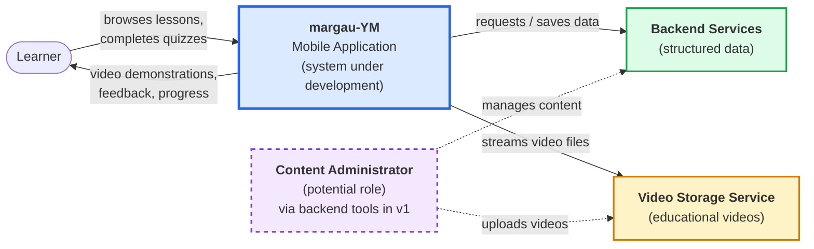
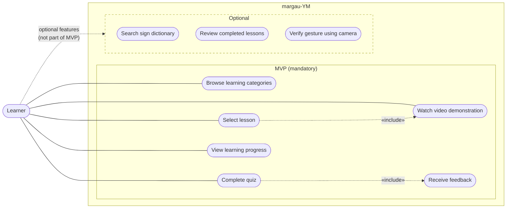

# KSL-5: Architecture Diagrams

Project: margau-YM, a mobile application for learning Kazakh Sign Language (KSL).

Editable source: [`KSL-5_architecture_diagrams.drawio`](KSL-5_architecture_diagrams.drawio) (draw.io, 3 pages: System Context, Use Case, Component).

The diagrams below are rendered by GitHub from Mermaid code. Dashed elements are optional or potential, not part of the mandatory MVP.

---

## Figure 1. System Context Diagram

| Element | Type | Description |
| --- | --- | --- |
| Learner | Actor | Browses lessons, completes quizzes, receives video demonstrations, feedback and progress |
| margau-YM Mobile Application | System under development | Main system |
| Backend Services | External service | Stores structured data (categories, lessons, questions, progress) |
| Video Storage Service | External service | Stores and streams educational videos |
| Content Administrator | Potential role (dashed) | Manages content and uploads videos via backend tools in v1 |

---

## Figure 2. Use Case Diagram

| Use case | Scope | Related requirement |
| --- | --- | --- |
| Browse learning categories | MVP | FR-01 |
| Select lesson | MVP | FR-02 |
| Watch video demonstration | MVP | FR-03 |
| Complete quiz | MVP | FR-04 |
| Receive feedback | MVP | FR-05 |
| View learning progress | MVP | FR-06, FR-07 |
| Search sign dictionary | Optional | FR-09 |
| Review completed lessons | Optional | FR-10 |
| Verify gesture using camera | Optional | FR-12 |

Relationships: *Select lesson* includes *Watch video demonstration*; *Complete quiz* includes *Receive feedback*.

---

## Figure 3. Component Diagram

```mermaid
flowchart TB
    subgraph APP["Mobile Application"]
        direction TB
        NAV["Navigation"]
        LC["Learning Content"]
        QZ["Quizzes"]
        PT["Progress Tracking"]
        MS["Mascot Interaction"]
        DAL["Data-Access Layer"]
    end

    subgraph BE["Backend Services"]
        direction LR
        DB[("Database<br/>categories, lessons,<br/>questions, user progress")]
        ST["Storage Service<br/>(educational video files)"]
    end

    NAV --> LC
    NAV --> QZ
    NAV --> PT
    QZ -->|"feedback"| MS
    PT -->|"encouragement"| MS
    LC --> DAL
    QZ --> DAL
    PT --> DAL
    DAL -->|"queries / saves data"| DB
    DAL -->|"streams video files"| ST
```

| Component | Responsibility |
| --- | --- |
| Navigation | Moves the learner between learning content, quizzes and progress |
| Learning Content | Shows categories, lessons and video demonstrations |
| Quizzes | Runs quizzes and evaluates answers |
| Progress Tracking | Records completed lessons and quiz results, shows progress |
| Mascot Interaction | Cat mascot: gives feedback after quizzes and encouragement for progress |
| Data-Access Layer | Single access point to the database and storage service |
| Database | Categories, lessons, questions, user progress |
| Storage Service | Educational video files |

> Architecture decisions (React Native + Expo, Supabase, Supabase Storage) are preliminary, see `KSL-4_system_technology_comparison.md`.
