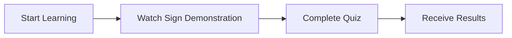

# KSL-6: Figma Prototype

Project: margau-YM, a mobile application for learning Kazakh Sign Language (KSL).

## Figma link

**Figma prototype:** https://www.figma.com/design/ISmwMRteSrldLLosOePPiw/margau-YM?node-id=0-1&p=f

## Overview

A preliminary user interface prototype of margau-YM was developed in Figma to visualize the application's core learning experience. The prototype follows a mobile-first design approach and incorporates video-based learning, interactive exercises, progress indicators, and mascot-supported feedback.

These screens represent the initial UX concept rather than a fully implemented application.

## Designed screens

| # | Screen | Description |
| --- | --- | --- |
| 1 | Welcome Screen | Introduces the application with the cat mascot as the central visual element. Options: start learning or log in. |
| 2 | Video Lesson Screen | Shows how users learn individual KSL signs: lesson progress indicator, sign demonstration video, instruction to repeat the gesture, and a continue button. |
| 3 | Interactive Quiz Screen | Presents a video demonstration and asks the user to choose the correct meaning from multiple-choice answers. Includes a question progress indicator and visual feedback through the cat mascot. |
| 4 | Lesson Results Screen | Shows motivational feedback, points earned, number of correct answers, mistakes, and a streak indicator. The cat mascot reinforces the positive learning experience. |

## Core learning scenario

## Visual style

- Dark teal primary color
- Neutral backgrounds
- Rounded interface elements
- Recognizable cat mascot character

## Related requirements

| Requirement | Covered by screen |
| --- | --- |
| FR-03 Video demonstrations | Video Lesson Screen |
| FR-04, FR-05 Quizzes and feedback | Interactive Quiz Screen |
| FR-06, FR-07 Results and progress | Lesson Results Screen |
| FR-08 Cat mascot | Welcome, Quiz and Results screens |

## Next design steps

Additional screens, including thematic categories, lesson selection, and learning progress, will be developed and refined during subsequent design stages. The prototype is intended to support evaluation of navigation, visual clarity, and consistency of the learning experience before implementation.

## Screenshots

Screenshots of the four screens can be stored in `docs/figma/` (for example `01_welcome.png`, `02_video_lesson.png`, `03_quiz.png`, `04_results.png`).
